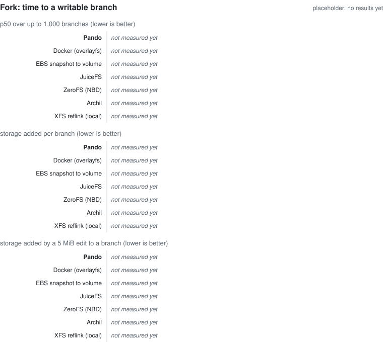
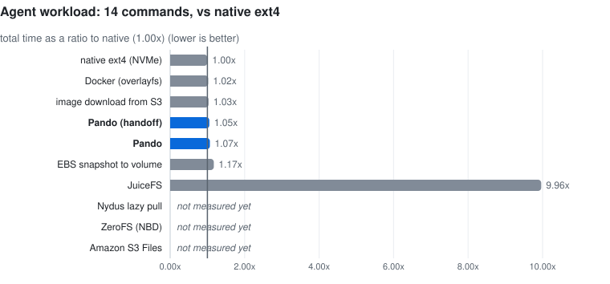
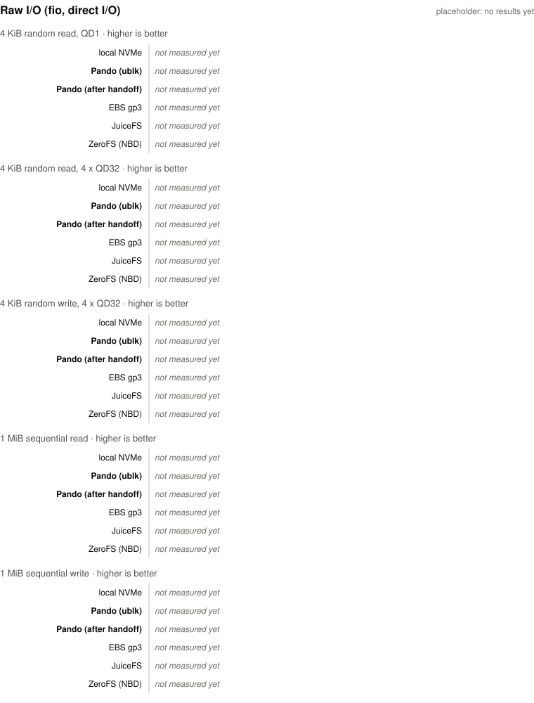

# Pando

[](https://github.com/usespotlightai/pando/actions/workflows/xfstests.yml?query=branch%3Amain)
[](LICENSE)

Writable branches of a large workspace for AI agents, stored in S3.

Each agent run needs its own copy of a repository and everything installed in it, often on a
machine where neither is present. It also needs to preserve its changes when the run ends.
Pando gives each run a block device backed by a branch of a shared base. Creating a branch takes
about 100 ms and adds one small ref object. The host fetches only what the run reads and uploads only what
it changed when the run ends. Any host with access to the bucket can open any branch.

Pando takes its name from a grove of aspens in Utah: a single organism with thousands of trunks
sharing one root system.

## How it works

- **Branches are block devices.** Pando serves each attached branch to the kernel over ublk, with
  a normal file system (ext4) on top. Agents see an ordinary disk, so `git`, `npm`
  and compilers work without changes. The disk has 4 KiB sectors, a volatile write cache with
  FUA, and discard: a discarded range reads as zeros, and its chunks no longer take space.
- **Chunks and branch refs.** The device is split into 64 KiB chunks named by their hash. A
  persistent radix tree maps each chunk index to a chunk. Each branch is one root entry in a
  small ref object, and forking copies that ref. Branches share every chunk they have not changed.
  A checkpoint freezes a branch's root under a name that never changes, so a host that has read it
  once forks from it with a single request to the store.
- **Segment storage.** Chunks and tree nodes are packed into ~8 MiB segments containing zstd
  frames of up to 1 MiB. A single range GET fetches neighbouring chunks, and uploads take a few
  PUTs rather than one per write. Where possible, changed chunks are stored as 4 KiB block
  references to the base, reducing the data uploaded by `npm ci` by about 13x.
- **Write-back with fencing.** A flush is immediately durable locally, reaches a write log in
  the store moments later, and uploads in the background. A conditional PUT updates the ref.
  Opening a branch takes a new writer generation that fences any older writer, and applies what
  the log has beyond the ref, so a lost host loses at most the last moments of writes. With
  `attach --log strict`, a flush returns only once the log in the store has it.
- **Fast starts.** Each host keeps a base image per root and clones it with reflink. A later
  branch of the same root therefore starts in about 250 ms. The first run records the frames it
  touched, and the next run on another host prefetches them. Once the branch is local, Pando
  hands the device to the kernel through device-mapper over a loop device and leaves the I/O path.
- **Crash safety.** ublk user recovery and a local journal preserve acknowledged writes through
  a daemon crash. After restarting, the daemon resumes serving the device where it left off. On
  SIGTERM it publishes what it holds and leaves the device to the next daemon, so an upgrade
  does not unmount anything. [docs/hosts.md](docs/hosts.md) covers running it under systemd.
- **Host daemon.** `pando serve --socket PATH` keeps the store's connections, the cache and the
  checkpoints it has read. `pando --socket PATH <command>` runs the command there, so a branch or
  attach skips process start-up, credential loading and cold connections.
- **A store per org.** Each org's branches live under a prefix of their own, with credentials
  that reach only that prefix: from the AWS chain, or from a file another process refreshes, such
  as R2 temporary credentials. A host's cache never serves two stores, and `pando purge` deletes a
  prefix. [docs/tenancy.md](docs/tenancy.md) has the policies and the steps for an org that
  leaves.

## Crates

| Crate | Contents |
|---|---|
| `pando-format` | the store format: hashes, entries, refs, checkpoints, tree nodes, frames, segment indexes, recipes, change lists, write log records, object keys. No I/O. |
| `pando-engine` | the volume engine: the block map tree, the cache, fetch and its scheduler, the uploader and writer fencing, dedup, base builds, seeding and the handoff steps. It reaches the outside world only through ports. |
| `pando-s3` | the object-store port over any S3-compatible store with conditional writes (AWS S3, Cloudflare R2, MinIO) |
| `pando-host` | the host ports on a real machine: files, base images, clock, randomness, CPU pool. Linux gets reflinks, extent hints and hole punching; other systems get plain fallbacks. |
| `pando-linux` | the ublk block device frontend and the device-mapper switch |
| `pando-dst` | deterministic simulation, crash and fault scenarios, and conformance suites for every port adapter |
| `pando` | the command-line tool |

## Installing

Releases have binaries for x86_64 and aarch64 Linux, checksums and build provenance.
[docs/hosts.md](docs/hosts.md) covers installing one and upgrading a host with attached
branches; [docs/releasing.md](docs/releasing.md) covers cutting one.

## Building

Build with Rust 1.100, pinned in `rust-toolchain.toml`. The block device requires Linux with
`ublk_drv`. After a handoff, snapshots clone only the chunks the kernel wrote when the host has
the `dm-era` target and `era_invalidate` from thin-provisioning-tools; without them each
snapshot clones the whole image, and every block written after it pays a copy-on-write. The
engine's tests run anywhere; on macOS, `pando-host` falls back to plain file
operations. To build and test the Linux crates from macOS, `tools/cargo.sh` runs cargo in a
Linux container and takes the same arguments.

```bash
cargo test --workspace
```

`tools/check.sh` runs the checks CI runs, in a container with every tool pinned
(`tools/Dockerfile`, `tools/install.sh`): with no arguments it runs the lints, the supply-chain
checks and the tests. It also takes `asan`, `fuzz [seconds]`, `coverage`, `mutants`, or any
single check by name, such as `clippy` or `shellcheck`. The fuzz targets are in `fuzz/`.
`tools/tlc.sh` model-checks the TLA+ specification of the write log in `specs/` and checks
traces of the engine against it ([specs/README.md](specs/README.md)).

Dependabot proposes weekly updates for the crates, actions, base images and Terraform providers
(`.github/dependabot.yml`). A crate update passes `vet` only once each new version has an audit
or exemption in `supply-chain/`. Dependabot moves the `rust` image only within its minor version,
so a new Rust release is a manual change to `rust-toolchain.toml`, `rust-version` in
`Cargo.toml`, and the `FROM` and `rustup` lines in `tools/Dockerfile`, all in one commit. The
nightly in `tools/nightly` and `fuzz/README.md` also moves by hand.

Fixtures in `pando-format/tests/fixtures` pin the byte encoding of every stored object.

## Alternatives

Pando is not a sandbox; it provides the disk beneath one. The comparisons below cover the storage
systems sandboxes are built on, using the same machine, bucket and agent workload. See
[Benchmarks](#benchmarks) for measured results and [bench/README.md](bench/README.md) for the
plan and methodology.

**Storage used by sandbox platforms**, according to their own docs and engineering posts:

| Approach | Used by | Benchmarked as |
|---|---|---|
| chunked block device over NBD from object storage, copy-on-write overlay | E2B | E2B-style (ZeroFS NBD, or E2B's own block layer) |
| compressed disk image in S3, cached on NVMe | Vercel Sandbox | image download |
| OCI image layers on overlayfs, FUSE mounts of object storage for volumes | Daytona | `docker pull`, SOCI lazy pull |
| lazy-loading, content-addressed FUSE file system | Modal | Nydus lazy pull |
| chunks in object storage, SQLite metadata, copy-on-write checkpoints | Fly.io Sprites | JuiceFS |
| reflink copies on local NVMe | CodeSandbox | XFS reflink (local only) |

Morph Cloud, Freestyle and Runloop have not published how they store disks.

**Comparison for Pando's intended workload:**

| | Writable fork | Fork cost | Starts on an empty host | Saves only the change |
|---|---|---|---|---|
| Pando | yes | ~130 ms, a 136 B ref | yes, fetches what it reads | yes, 4 KiB dedup |
| image or tar from S3 | copy | full copy | downloads everything | no |
| OCI layers on overlayfs | yes | ms on a host with the image | pulls the image (lazily with SOCI / Nydus) | a new layer per save |
| EBS snapshot to volume | yes | seconds to create | lazy-loaded, slow first reads | incremental snapshots, minutes |
| overlayfs, btrfs, XFS reflink, ZFS | yes | ms | no, local only | no |
| JuiceFS | `juicefs clone` | metadata copy, grows with files | yes | yes |
| ZeroFS | no, read-only checkpoints | full copy of the device file | yes, no data prefetch | yes, no dedup |
| Amazon S3 Files | no | copy | yes | per file |
| Archil | yes (enterprise on your own bucket) | ? | yes | yes |

## Benchmarks

> **The results come from four runs** on the same bench VM (AWS `m8id.4xlarge`, eu-north-1; see
> [bench/README.md](bench/README.md)): Pando's fork, fio and kill -9 crash rows from main at
> `a871f16`, Pando's other rows from main at `d57f1de`, SOCI, Nydus, ZeroFS and Amazon S3 Files
> from the run before those, and the other systems from the first run.
> Run `python3 bench/plot.py` to redraw the charts from `bench/results/`.

The workspace is [Spotlight](https://github.com/usespotlightai/spotlight) after its setup command:
1.4 GB and 129k files. All systems use the same VM and bucket. Results show medians of 5 runs,
with Pando in blue. "Pando" serves the branch over ublk until it is detached; "Pando (handoff)"
adds `--dm` and `--images`, so the device switches to a local image once the branch is local.

### Fork

Time to create a writable branch, and the storage each branch and each edit adds. Docker and
XFS reflink branches exist only on the host's disk. Pando, JuiceFS, EBS, ZeroFS and S3 Files
branches are durable and open on any host, so each fork waits on the network. These rows are from
one run so far, not five. JuiceFS made 100 branches, EBS and ZeroFS 10, and S3 Files 3; the others
made 1,000. ZeroFS has only read-only checkpoints, so a writable branch is a copy of the device
file. S3 Files has no branches, so a branch is a copy of every file through the mount. On Pando a
5 MiB edit adds 5.08 MiB to the store: 5.05 MiB of segments and the rest change records and hints.
At `d57f1de` it added 7.58 MiB, because a write-log record still in upload when the log closed was
never deleted; that is fixed.

<!-- bench:fork -->
<picture>
  <source media="(prefers-color-scheme: dark)" srcset="docs/bench/fork-dark.svg">
  
</picture>

<details>
<summary>Numbers</summary>

| p50 over up to 1,000 branches | median | range |
|---|---|---|
| Pando | 129 ms | 129 ms to 129 ms |
| Docker (overlayfs, local) | 11.1 ms | 11.1 ms to 11.1 ms |
| EBS snapshot to volume | 2.6 s | 2.6 s to 2.6 s |
| JuiceFS | 12.8 s | 12.8 s to 12.8 s |
| ZeroFS (NBD) | 12.9 s | 12.9 s to 12.9 s |
| Amazon S3 Files | 2.05 min | 2.05 min to 2.05 min |
| XFS reflink (local) | 1 ms | 1 ms to 1 ms |

| storage added per branch | median | range |
|---|---|---|
| Pando | 136 B | 136 B to 136 B |
| Docker (overlayfs, local) | 36.5 KiB | 36.5 KiB to 36.5 KiB |
| EBS snapshot to volume | 16 GiB | 16 GiB to 16 GiB |
| JuiceFS | 25.4 MiB | 25.4 MiB to 25.4 MiB |
| ZeroFS (NBD) | 415 MiB | 415 MiB to 415 MiB |
| Amazon S3 Files | 1.3 GiB | 1.3 GiB to 1.3 GiB |
| XFS reflink (local) | 4.61 KiB | 4.61 KiB to 4.61 KiB |

| storage added by a 5 MiB edit to a branch | median | range |
|---|---|---|
| Pando | 5.08 MiB | 5.08 MiB to 5.08 MiB |
| Docker (overlayfs, local) | 5 MiB | 5 MiB to 5 MiB |
| EBS snapshot to volume | none: billed by volume size | |
| JuiceFS | 5 MiB | 5 MiB to 5 MiB |
| ZeroFS (NBD) | 26.5 MiB | 26.5 MiB to 26.5 MiB |
| Amazon S3 Files | 5 MiB | 5 MiB to 5 MiB |
| XFS reflink (local) | 5.75 MiB | 5.75 MiB to 5.75 MiB |

</details>
<!-- /bench:fork -->

### Cold start

Time to fork, mount and finish the first `git status` on a host that has never seen the workspace.
Pando's slowest repetition, 2.6 s, is the first mount of the base; later mounts prefetch the
reads it recorded in the bucket. SOCI and Nydus open in seconds because they fetch file contents
only on first read, so their `git status` is the slower part. ZeroFS copies its device file and
S3 Files copies every file for each branch; S3 Files ran 3 times, not 5.

<!-- bench:cold -->
<picture>
  <source media="(prefers-color-scheme: dark)" srcset="docs/bench/cold-dark.svg">
  
</picture>

<details>
<summary>Numbers</summary>

| fork, mount and git status done | median | range |
|---|---|---|
| Pando | 1.22 s | 1.16 s to 2.83 s |
| Pando (handoff) | 1.21 s | 1.19 s to 2.32 s |
| tar from S3 | 4.44 s | 4.41 s to 4.48 s |
| image download from S3 | 4.72 s | 4.69 s to 4.79 s |
| Docker (overlayfs) | 26.9 s | 26.8 s to 27.3 s |
| SOCI lazy pull | 6.01 s | 5.89 s to 6.74 s |
| Nydus lazy pull | 3.66 s | 3.5 s to 3.77 s |
| EBS snapshot to volume | 10.9 s | 10.1 s to 12 s |
| JuiceFS | 3.88 min | 3.8 min to 3.92 min |
| ZeroFS (NBD) | 15 s | 14.6 s to 15.6 s |
| Amazon S3 Files | 3.55 min | 3.49 min to 4.76 min |
| XFS reflink (local) | local only | |

</details>
<!-- /bench:cold -->

### Warm start

Time to start on a host that has already run a branch of the same base. Each system has its
base on the host: Docker's image is pulled, tar and the image download have their file cached,
and Pando (handoff) has the host's base image of the root. The page cache is dropped before each
run. Pando (handoff) switches to the image as soon as the branch opens, so `git status` reads
through device-mapper and a loop device over a reflink clone and takes about 1 s, against 0.47 s
over ublk. SOCI and Nydus keep the contents they fetched in their snapshotter's cache. S3 Files
copies every file again for each branch, so its warm start is as slow as its cold start.

<!-- bench:warm -->
<picture>
  <source media="(prefers-color-scheme: dark)" srcset="docs/bench/warm-dark.svg">
  
</picture>

<details>
<summary>Numbers</summary>

| fork, mount and git status done | median | range |
|---|---|---|
| Pando | 1.31 s | 1.29 s to 1.32 s |
| Pando (handoff) | 1.75 s | 1.68 s to 1.81 s |
| tar from S3 | 2.51 s | 2.5 s to 2.52 s |
| image download from S3 | 2.8 s | 2.8 s to 3.12 s |
| Docker (overlayfs) | 1.27 s | 1.23 s to 1.31 s |
| SOCI lazy pull | 2.19 s | 2.12 s to 2.29 s |
| Nydus lazy pull | 1.33 s | 1.14 s to 1.43 s |
| EBS snapshot to volume | 11 s | 10.5 s to 11.4 s |
| JuiceFS | 18.8 s | 18.4 s to 19.1 s |
| ZeroFS (NBD) | 14.8 s | 14.3 s to 15.1 s |
| Amazon S3 Files | 3.79 min | 3.69 min to 3.95 min |
| XFS reflink (local) | 563 ms | 410 ms to 613 ms |

</details>
<!-- /bench:warm -->

### Agent workload

Time to run the 14 command types agents use most often in Spotlight sandboxes (`git status`, `tsc`,
`oxlint`, `vitest`, `npm ci`, ...), expressed as a ratio to native ext4 on local NVMe. Each system
ran the replay 3 times on a fresh branch of a warm host, page cache dropped, against native in the
same run: 71.5 s in Pando's run, 70.3 s in the run of SOCI, Nydus, ZeroFS and S3 Files, and 70.5 s
in the first run. Most of JuiceFS's time is `npm ci`, about 9.5 min against 7.6 s; in its first
repetition one `vitest` run failed, and it passed in the other two. On S3 Files, where every file
operation is an NFS round trip, `npm ci` takes about 9.7 min, the first `git status` 44 s and the
control-plane `tsc` and `vitest` 74 s and 83 s.

<!-- bench:replay -->
<picture>
  <source media="(prefers-color-scheme: dark)" srcset="docs/bench/replay-dark.svg">
  
</picture>

<details>
<summary>Numbers</summary>

| total time as a ratio to native (1.00x) | median | range |
|---|---|---|
| native ext4 (NVMe) | 1.00x | 1.00x to 1.00x |
| Pando | 1.03x | 1.03x to 1.16x |
| Pando (handoff) | 1.02x | 1.02x to 1.06x |
| image download from S3 | 1.03x | 1.03x to 1.04x |
| Docker (overlayfs) | 1.02x | 1.02x to 1.03x |
| SOCI lazy pull | 1.21x | 1.20x to 1.34x |
| Nydus lazy pull | 1.10x | 1.08x to 1.12x |
| EBS snapshot to volume | 1.17x | 1.16x to 1.23x |
| JuiceFS | 9.96x | 9.90x to 12.07x |
| ZeroFS (NBD) | 1.16x | 1.12x to 1.17x |
| Amazon S3 Files | 11.82x | 11.75x to 11.84x |

</details>
<!-- /bench:replay -->

### Save

After `npm ci`, time from the last write until another host can open the branch, and the bytes
`npm ci`'s changes added to the store. Pando's time is unmount and `pando detach`, which uploads
what changed since its last background snapshot and publishes the branch. JuiceFS uploads each
file as it closes, so its save is a `sync` that finds nothing left, and the upload cost lands in
`npm ci` itself: about 15 min on JuiceFS against 8 s on the others. tar uploads the whole
workspace every time. EBS's bytes are the 512 KiB blocks the snapshot holds beyond the workspace
snapshot. ZeroFS's save is unmount and `nbd-client -d`, which flush the device to ZeroFS and the
bucket. On S3 Files, `npm ci` takes about 10 min over NFS; another host's mount reads each file as
soon as it is closed, so its save is a `sync -f` that finds nothing left. Its bytes are every
object version written, as S3 Files stores each file as a whole object, about a minute after its
last write. Three runs each, five for Pando.

<!-- bench:save -->
<picture>
  <source media="(prefers-color-scheme: dark)" srcset="docs/bench/save-dark.svg">
  
</picture>

<details>
<summary>Numbers</summary>

| time to durable after npm ci | median | range |
|---|---|---|
| Pando | 2.65 s | 2.21 s to 5.97 s |
| tar from S3 | 3.2 s | 3.17 s to 3.2 s |
| Docker (overlayfs) | 41.1 s | 40.9 s to 41.2 s |
| EBS snapshot to volume | 93.9 s | 83.8 s to 102 s |
| JuiceFS | 2.76 ms | 2.5 ms to 3.52 ms |
| ZeroFS (NBD) | 12.4 s | 10.6 s to 14.1 s |
| Amazon S3 Files | 6.65 ms | 5.66 ms to 7.31 ms |

| uploaded after npm ci | median | range |
|---|---|---|
| Pando | 216 MiB | 208 MiB to 217 MiB |
| tar from S3 | 323 MiB | 323 MiB to 323 MiB |
| Docker (overlayfs) | 194 MiB | 194 MiB to 194 MiB |
| EBS snapshot to volume | 1.05 GiB | 1.05 GiB to 1.05 GiB |
| JuiceFS | 732 MiB | 665 MiB to 785 MiB |
| ZeroFS (NBD) | 318 MiB | 301 MiB to 320 MiB |
| Amazon S3 Files | 1.56 GiB | 1.42 GiB to 1.65 GiB |

</details>
<!-- /bench:save -->

### Raw I/O

Direct I/O with fio on a 1 GiB file in a fresh branch's file system, three runs each, five for
Pando. Pando (ublk) reads come out ahead of the local NVMe because its daemon keeps the branch in
cache files read through the host's page cache: direct I/O skips the page cache of the device, not
of the daemon, so those rows mostly measure memory. Its writes do not: sequential writes match the
NVMe, and 4 KiB random writes reach about 123k IOPS, near the NVMe's 134k. At `d57f1de` they reached
only 14k: each dirty 4 KiB write held a whole 64 KiB chunk in memory, so the dirty-memory limit held
random writes to the speed of full-chunk flushes. Dirty writes now stay in the journal. During these
runs at `a871f16`, the daemon's memory grew with each run, to a peak of 1,060 MiB: the object log
index and the uploader's map of uploaded objects kept every chunk version. Since then, sweeps drop
old chunk versions from the object log, and the uploader's map is gone. In a local run of 10 rounds
of 4 KiB random writes over a 1 GiB file, the object log stayed between 2.6 and 5.2 GB on disk over
21.6 GB written; the bench rows have not been rerun since. The after-handoff rows are from
`d57f1de`. After handoff, I/O goes through device-mapper and a loop device to the image on the NVMe
and runs at the NVMe's speed. EBS gp3 runs at its baseline of 3,000 IOPS and 125 MiB/s. On ZeroFS
every request goes over NBD to its server and on S3 Files over NFS to the file system, so a single 4
KiB read waits on a round trip: about 240 IOPS on S3 Files.

<!-- bench:fio -->
<picture>
  <source media="(prefers-color-scheme: dark)" srcset="docs/bench/fio-dark.svg">
  
</picture>

<details>
<summary>Numbers</summary>

| 4 KiB random read, QD1 | median | range |
|---|---|---|
| local NVMe | 11k | 10.4k to 11.1k |
| Pando (ublk) | 107k | 104k to 110k |
| Pando (after handoff) | 7.78k | 5.73k to 8.2k |
| EBS gp3 | 1.54k | 1.54k to 1.6k |
| JuiceFS | 6.37k | 5.98k to 6.58k |
| ZeroFS (NBD) | 5.99k | 4.55k to 6.77k |
| Amazon S3 Files | 243 | 228 to 245 |

| 4 KiB random read, 4 x QD32 | median | range |
|---|---|---|
| local NVMe | 269k | 269k to 269k |
| Pando (ublk) | 820k | 820k to 825k |
| Pando (after handoff) | 254k | 252k to 255k |
| EBS gp3 | 2.99k | 2.99k to 3k |
| JuiceFS | 76.7k | 76.4k to 77.3k |
| ZeroFS (NBD) | 31.7k | 28.4k to 32.7k |
| Amazon S3 Files | 24.7k | 16.7k to 25.1k |

| 4 KiB random write, 4 x QD32 | median | range |
|---|---|---|
| local NVMe | 134k | 134k to 134k |
| Pando (ublk) | 123k | 123k to 125k |
| Pando (after handoff) | 132k | 131k to 132k |
| EBS gp3 | 2.99k | 2.99k to 3k |
| JuiceFS | 484 | 456 to 493 |
| ZeroFS (NBD) | 1.32k | 1.23k to 1.54k |
| Amazon S3 Files | 4.83k | 4.49k to 4.87k |

| 1 MiB sequential read | median | range |
|---|---|---|
| local NVMe | 1,910 MB/s | 1,910 MB/s to 1,910 MB/s |
| Pando (ublk) | 6,732 MB/s | 6,687 MB/s to 7,027 MB/s |
| Pando (after handoff) | 1,910 MB/s | 1,910 MB/s to 1,910 MB/s |
| EBS gp3 | 131 MB/s | 131 MB/s to 131 MB/s |
| JuiceFS | 1,611 MB/s | 1,576 MB/s to 1,660 MB/s |
| ZeroFS (NBD) | 545 MB/s | 529 MB/s to 594 MB/s |
| Amazon S3 Files | 484 MB/s | 482 MB/s to 488 MB/s |

| 1 MiB sequential write | median | range |
|---|---|---|
| local NVMe | 908 MB/s | 908 MB/s to 908 MB/s |
| Pando (ublk) | 906 MB/s | 906 MB/s to 940 MB/s |
| Pando (after handoff) | 902 MB/s | 901 MB/s to 902 MB/s |
| EBS gp3 | 131 MB/s | 131 MB/s to 131 MB/s |
| JuiceFS | 1,328 MB/s | 1,317 MB/s to 1,330 MB/s |
| ZeroFS (NBD) | 190 MB/s | 180 MB/s to 226 MB/s |
| Amazon S3 Files | 186 MB/s | 184 MB/s to 188 MB/s |

</details>
<!-- /bench:fio -->

### Crash

The storage daemon is killed with `kill -9` while a writer writes and fsyncs 256 KiB files, and is
restarted at once (`pando attach --recover`, a new JuiceFS mount, a new ZeroFS server on the same
cache; S3 Files' `efs-proxy` is restarted by the efs-utils watchdog). The branch is then opened
with a new cache and state directory, sharing nothing with the first, its file system checked and
every acknowledged file read back. Medians of three runs, five for Pando. ZeroFS did not recover:
its NBD client does not reconnect to the new server, so writes hang until the harness disconnects
the device after 120 s. What it acknowledged before the kill was intact.

| System | Failed writes | Stall | fsck | Files correct |
|---|---|---|---|---|
| Pando | 0 | 0.15 s | clean | all acknowledged (1,390 to 1,440 per run) |
| JuiceFS | 2 | 0.23 s | clean | all acknowledged (264 to 270 per run) |
| ZeroFS | 1 | did not recover | clean | all acknowledged (20 per run) |
| Amazon S3 Files | 0 | 3.16 s | no checker | all acknowledged (348 to 352 per run) |

At `d57f1de`, one of Pando's five runs failed 4 writes and left file system errors (`e2fsck` exit
4): the restarted daemon reused a temporary file name that the killed one had left behind. That is
fixed, and at `a871f16` all five runs were clean.

At `d57f1de` Pando also ran a reboot case five times: the same writer, and five seconds in the host
reboots through `/proc/sysrq-trigger`, which neither syncs nor unmounts, as a power loss would.
After the boot, `pando attach --recover=auto` served the branch in 3.2 s (2.8 s to 3.9 s), `e2fsck
-fn` found the file system clean there and again on a fresh host, and every acknowledged file (804
to 836 per run) read back correctly on both.
