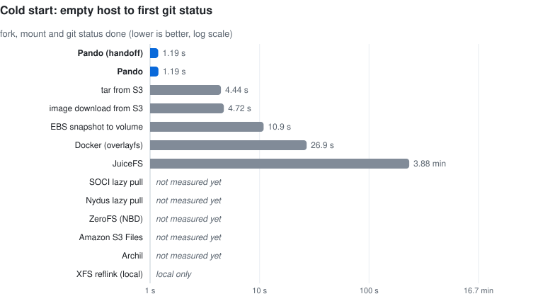
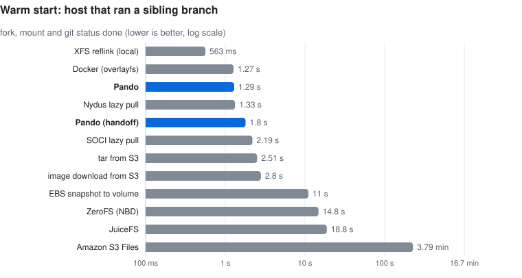

# Pando

Writable branches of a large workspace for AI agents, stored in S3.

Each agent run needs its own copy of a repository and everything installed in it, often on a
machine where neither is present. It also needs to preserve its changes when the run ends.
Pando gives each run a block device backed by a branch of a shared base. Creating a branch takes
about 100 ms and adds one small ref object. The host fetches only what the run reads and uploads only what
it changed when the run ends. Any host with access to the bucket can open any branch.

Pando takes its name from a grove of aspens in Utah: a single organism with thousands of trunks
sharing one root system.

## How it works

- **Branches are block devices.** Pando serves each attached branch to the kernel over ublk, with
  a normal file system (ext4) on top. Agents see an ordinary disk, so `git`, `npm`
  and compilers work without changes.
- **Chunks and branch refs.** The device is split into 64 KiB chunks named by their hash. A
  persistent radix tree maps each chunk index to a chunk. Each branch is one root entry in a
  small ref object, and forking copies that ref. Branches share every chunk they have not changed.
- **Segment storage.** Chunks and tree nodes are packed into ~8 MiB segments containing zstd
  frames of up to 1 MiB. A single range GET fetches neighbouring chunks, and uploads take a few
  PUTs rather than one per write. Where possible, changed chunks are stored as 4 KiB block
  references to the base, reducing the data uploaded by `npm ci` by about 13x.
- **Write-back with fencing.** A flush is immediately durable locally and uploads in the
  background. A conditional PUT updates the ref. Opening a branch takes a new writer generation
  that fences any older writer.
- **Fast starts.** Each host keeps a base image per root and clones it with reflink. A later
  branch of the same root therefore starts in about 250 ms. The first run records the frames it
  touched, and the next run on another host prefetches them. Once the branch is local, Pando
  hands the device to the kernel through device-mapper over a loop device and leaves the I/O path.
- **Crash safety.** ublk user recovery and a local journal preserve acknowledged writes through
  a daemon crash. After restarting, the daemon resumes serving the device where it left off.

## Crates

| Crate | Contents |
|---|---|
| `pando-format` | the store format: hashes, entries, refs, tree nodes, frames, segment indexes, recipes, change lists, object keys. No I/O. |
| `pando-engine` | the volume engine: the block map tree, the cache, fetch and its scheduler, the uploader and writer fencing, dedup, base builds, seeding and the handoff steps. It reaches the outside world only through ports. |
| `pando-s3` | the object-store port over any S3-compatible store with conditional writes (AWS S3, Cloudflare R2, MinIO) |
| `pando-host` | the host ports on a real machine: files, base images, clock, randomness, CPU pool. Linux gets reflinks, extent hints and hole punching; other systems get plain fallbacks. |
| `pando-linux` | the ublk block device frontend and the device-mapper switch |
| `pando-dst` | deterministic simulation, crash and fault scenarios, and conformance suites for every port adapter |
| `pando` | the command-line tool |

## Building

Build with Rust 1.100, pinned in `rust-toolchain.toml`. The block device requires Linux with
`ublk_drv`. The engine's tests run anywhere; on macOS, `pando-host` falls back to plain file
operations. To build and test the Linux crates from macOS, `tools/cargo.sh` runs cargo in a
Linux container and takes the same arguments.

```bash
cargo test --workspace
```

Fixtures in `pando-format/tests/fixtures` pin the byte encoding of every stored object.

## Alternatives

Pando is not a sandbox; it provides the disk beneath one. The comparisons below cover the storage
systems sandboxes are built on, using the same machine, bucket and agent workload. See
[Benchmarks](#benchmarks) for measured results and [bench/README.md](bench/README.md) for the
plan and methodology.

**Storage used by sandbox platforms**, according to their own docs and engineering posts:

| Approach | Used by | Benchmarked as |
|---|---|---|
| chunked block device over NBD from object storage, copy-on-write overlay | E2B | E2B-style (ZeroFS NBD, or E2B's own block layer) |
| compressed disk image in S3, cached on NVMe | Vercel Sandbox | image download |
| OCI image layers on overlayfs, FUSE mounts of object storage for volumes | Daytona | `docker pull`, SOCI lazy pull |
| lazy-loading, content-addressed FUSE file system | Modal | Nydus / eStargz lazy pull |
| chunks in object storage, SQLite metadata, copy-on-write checkpoints | Fly.io Sprites | JuiceFS |
| reflink copies on local NVMe | CodeSandbox | XFS reflink (local only) |

Morph Cloud, Freestyle and Runloop have not published how they store disks.

**Comparison for Pando's intended workload:**

| | Writable fork | Fork cost | Starts on an empty host | Saves only the change |
|---|---|---|---|---|
| Pando | yes | ~100 ms, a 135 B ref | yes, fetches what it reads | yes, 4 KiB dedup |
| image or tar from S3 | copy | full copy | downloads everything | no |
| OCI layers on overlayfs | yes | ms on a host with the image | pulls the image (lazily with SOCI / Nydus) | a new layer per save |
| EBS snapshot to volume | yes | seconds to create | lazy-loaded, slow first reads | incremental snapshots, minutes |
| overlayfs, btrfs, XFS reflink, ZFS | yes | ms | no, local only | no |
| JuiceFS | `juicefs clone` | metadata copy, grows with files | yes | yes |
| ZeroFS | no, read-only checkpoints | full copy of the device file | yes, no data prefetch | yes, no dedup |
| Amazon S3 Files | no | copy | yes | per file |
| Archil | yes (enterprise on your own bucket) | ? | yes | yes |

## Benchmarks

> **Partly measured.** The fork and cold-start charts have results so far; the others fill in
> as their runs finish on the bench VM (AWS `m8id.4xlarge`, eu-north-1; see
> [bench/README.md](bench/README.md)). Run `python3 bench/plot.py` to redraw them from
> `bench/results/`.

The workspace is [Spotlight](https://github.com/usespotlightai/spotlight) after its setup command:
1.4 GB and 129k files. All systems use the same VM and bucket. Results show medians of 5 runs,
with Pando in blue.

### Fork

Time to create a writable branch, and the storage each branch and each edit adds. Docker and
XFS reflink branches exist only on the host's disk. Pando, JuiceFS and EBS branches are durable
and open on any host, so each fork waits on the network. These rows are from one run so far, not
five. JuiceFS made 100 branches and EBS 10; the others made 1,000.

<!-- bench:fork -->
<picture>
  <source media="(prefers-color-scheme: dark)" srcset="docs/bench/fork-dark.svg">
  
</picture>

<details>
<summary>Numbers</summary>

| p50 over up to 1,000 branches | median | range |
|---|---|---|
| Pando | 106 ms | 106 ms to 106 ms |
| Docker (overlayfs, local) | 11.1 ms | 11.1 ms to 11.1 ms |
| EBS snapshot to volume | 2.6 s | 2.6 s to 2.6 s |
| JuiceFS | 12.8 s | 12.8 s to 12.8 s |
| ZeroFS (NBD) | — | |
| Archil | — | |
| XFS reflink (local) | 1 ms | 1 ms to 1 ms |

| storage added per branch | median | range |
|---|---|---|
| Pando | 135 B | 135 B to 135 B |
| Docker (overlayfs, local) | 36.5 KiB | 36.5 KiB to 36.5 KiB |
| EBS snapshot to volume | 16 GiB | 16 GiB to 16 GiB |
| JuiceFS | 25.4 MiB | 25.4 MiB to 25.4 MiB |
| ZeroFS (NBD) | — | |
| Archil | — | |
| XFS reflink (local) | 4.61 KiB | 4.61 KiB to 4.61 KiB |

| storage added by a 5 MiB edit to a branch | median | range |
|---|---|---|
| Pando | 5.08 MiB | 5.08 MiB to 5.08 MiB |
| Docker (overlayfs, local) | 5 MiB | 5 MiB to 5 MiB |
| EBS snapshot to volume | none: billed by volume size | |
| JuiceFS | 5 MiB | 5 MiB to 5 MiB |
| ZeroFS (NBD) | — | |
| Archil | — | |
| XFS reflink (local) | 5.75 MiB | 5.75 MiB to 5.75 MiB |

</details>
<!-- /bench:fork -->

### Cold start

Time to fork, mount and finish the first `git status` on a host that has never seen the workspace.
Pando's slowest repetition, 2.6 s, is the first mount of the base; later mounts prefetch the
reads it recorded in the bucket.

<!-- bench:cold -->
<picture>
  <source media="(prefers-color-scheme: dark)" srcset="docs/bench/cold-dark.svg">
  
</picture>

<details>
<summary>Numbers</summary>

| fork, mount and git status done | median | range |
|---|---|---|
| Pando | 1.19 s | 1.15 s to 2.6 s |
| tar from S3 | 4.44 s | 4.41 s to 4.48 s |
| image download from S3 | 4.72 s | 4.69 s to 4.79 s |
| Docker (overlayfs) | 26.9 s | 26.8 s to 27.3 s |
| SOCI lazy pull | — | |
| Nydus lazy pull | — | |
| EBS snapshot to volume | 10.9 s | 10.1 s to 12 s |
| JuiceFS | 3.88 min | 3.8 min to 3.92 min |
| ZeroFS (NBD) | — | |
| Amazon S3 Files | — | |
| Archil | — | |
| XFS reflink (local) | local only | |

</details>
<!-- /bench:cold -->

### Warm start

Time to start on a host that has already run a branch of the same base.

<!-- bench:warm -->
<picture>
  <source media="(prefers-color-scheme: dark)" srcset="docs/bench/warm-dark.svg">
  
</picture>

<details>
<summary>Numbers</summary>

| fork, mount and git status done | median | range |
|---|---|---|
| Pando | — | |
| tar from S3 | — | |
| image download from S3 | — | |
| Docker (overlayfs) | — | |
| SOCI lazy pull | — | |
| Nydus lazy pull | — | |
| EBS snapshot to volume | — | |
| JuiceFS | — | |
| ZeroFS (NBD) | — | |
| Amazon S3 Files | — | |
| Archil | — | |
| XFS reflink (local) | — | |

</details>
<!-- /bench:warm -->

### Agent workload

Time to run the 14 command types agents use most often in Spotlight sandboxes (`git status`,
`tsc`, `oxlint`, `vitest`, `npm ci`, ...), expressed as a ratio to native ext4 on local NVMe.

<!-- bench:replay -->
<picture>
  <source media="(prefers-color-scheme: dark)" srcset="docs/bench/replay-dark.svg">
  
</picture>

<details>
<summary>Numbers</summary>

| total time as a ratio to native (1.00x) | median | range |
|---|---|---|
| native ext4 (NVMe) | — | |
| Pando | — | |
| image download from S3 | — | |
| Docker (overlayfs) | — | |
| Nydus lazy pull | — | |
| EBS snapshot to volume | — | |
| JuiceFS | — | |
| ZeroFS (NBD) | — | |
| Amazon S3 Files | — | |
| Archil | — | |

</details>
<!-- /bench:replay -->

### Save

After `npm ci`, time from the last write until another host can open the branch.

<!-- bench:save -->
<picture>
  <source media="(prefers-color-scheme: dark)" srcset="docs/bench/save-dark.svg">
  
</picture>

<details>
<summary>Numbers</summary>

| time to durable after npm ci | median | range |
|---|---|---|
| Pando | — | |
| tar from S3 | — | |
| Docker (overlayfs) | — | |
| EBS snapshot to volume | — | |
| JuiceFS | — | |
| ZeroFS (NBD) | — | |
| Archil | — | |

| uploaded after npm ci | median | range |
|---|---|---|
| Pando | — | |
| tar from S3 | — | |
| Docker (overlayfs) | — | |
| EBS snapshot to volume | — | |
| JuiceFS | — | |
| ZeroFS (NBD) | — | |
| Archil | — | |

</details>
<!-- /bench:save -->

### Raw I/O

Direct I/O measured with fio on the device or mount.

<!-- bench:fio -->
<picture>
  <source media="(prefers-color-scheme: dark)" srcset="docs/bench/fio-dark.svg">
  
</picture>

<details>
<summary>Numbers</summary>

| 4 KiB random read, QD1 | median | range |
|---|---|---|
| local NVMe | — | |
| Pando (ublk) | — | |
| Pando (after handoff) | — | |
| EBS gp3 | — | |
| JuiceFS | — | |
| ZeroFS (NBD) | — | |

| 4 KiB random read, 4 x QD32 | median | range |
|---|---|---|
| local NVMe | — | |
| Pando (ublk) | — | |
| Pando (after handoff) | — | |
| EBS gp3 | — | |
| JuiceFS | — | |
| ZeroFS (NBD) | — | |

| 4 KiB random write, 4 x QD32 | median | range |
|---|---|---|
| local NVMe | — | |
| Pando (ublk) | — | |
| Pando (after handoff) | — | |
| EBS gp3 | — | |
| JuiceFS | — | |
| ZeroFS (NBD) | — | |

| 1 MiB sequential read | median | range |
|---|---|---|
| local NVMe | — | |
| Pando (ublk) | — | |
| Pando (after handoff) | — | |
| EBS gp3 | — | |
| JuiceFS | — | |
| ZeroFS (NBD) | — | |

| 1 MiB sequential write | median | range |
|---|---|---|
| local NVMe | — | |
| Pando (ublk) | — | |
| Pando (after handoff) | — | |
| EBS gp3 | — | |
| JuiceFS | — | |
| ZeroFS (NBD) | — | |

</details>
<!-- /bench:fio -->

### Crash

The storage daemon is killed with `kill -9` during writes, then the branch is opened on a fresh host.

| System | Failed writes | Stall | fsck | Files correct |
|---|---|---|---|---|
| Pando | — | — | — | — |
| JuiceFS | — | — | — | — |
| ZeroFS | — | — | — | — |
